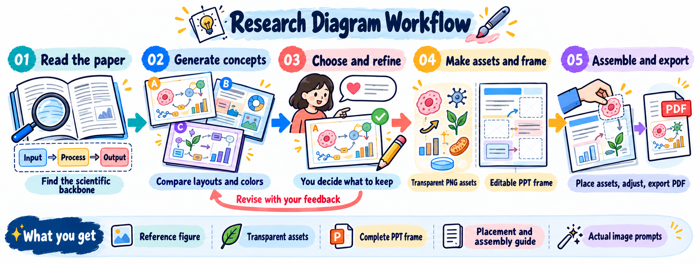
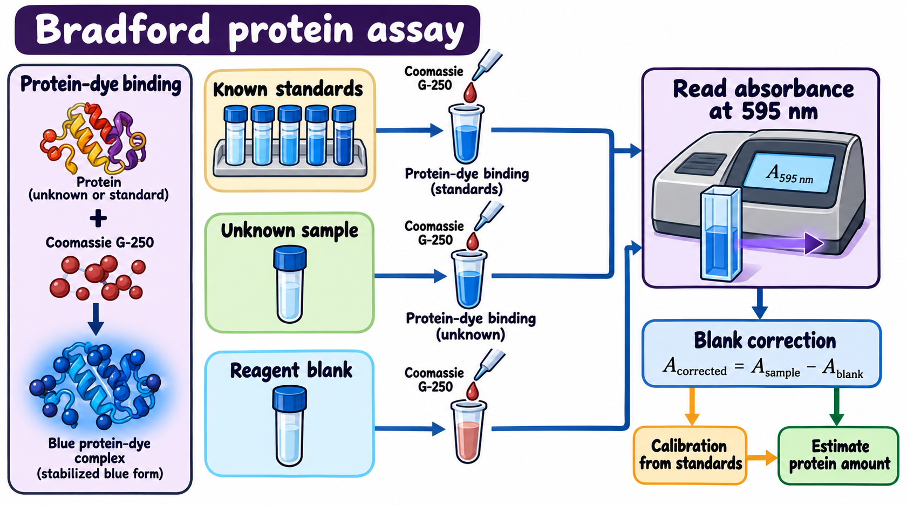
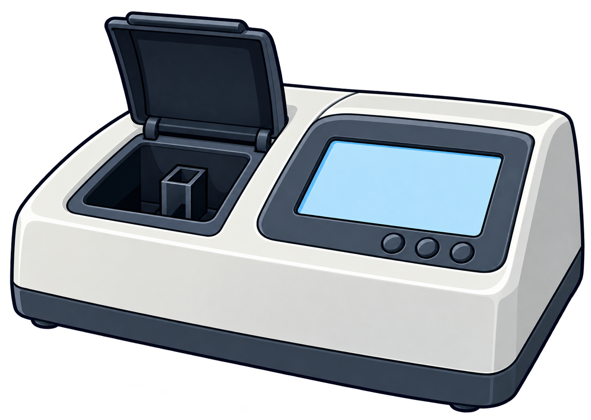
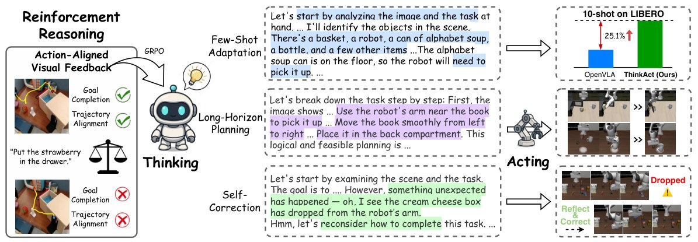
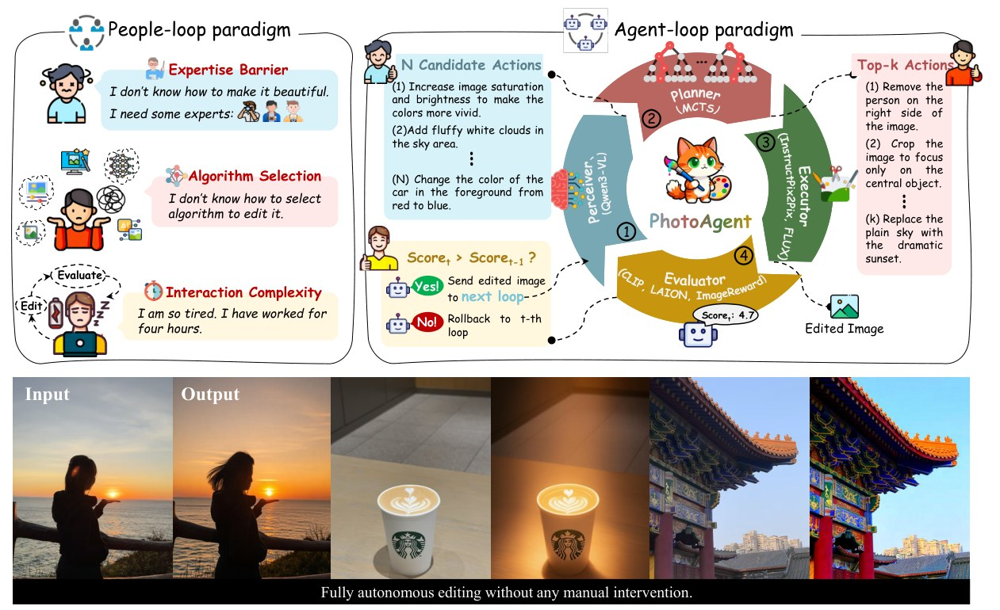
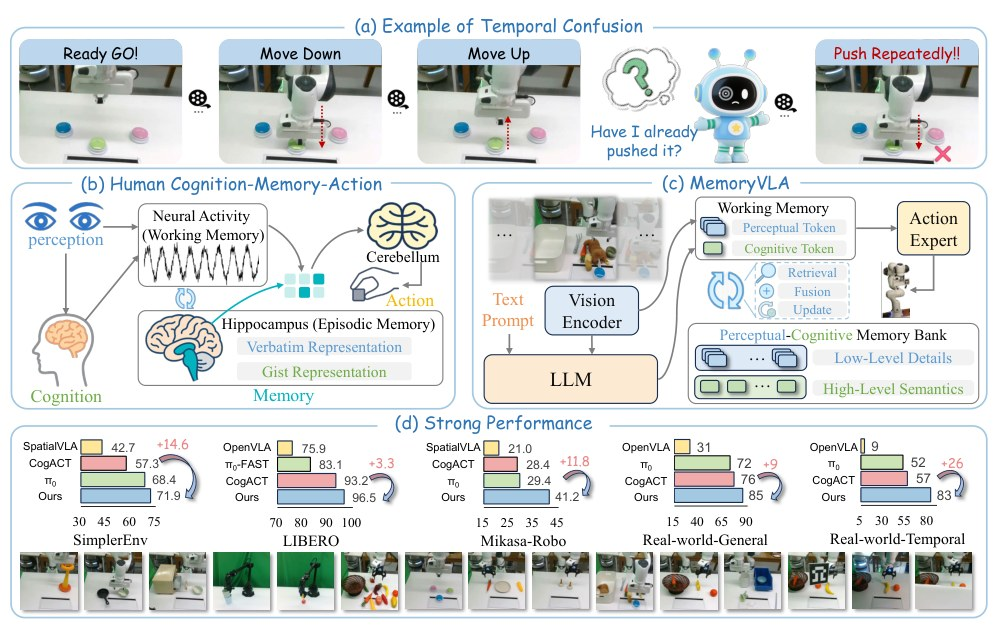
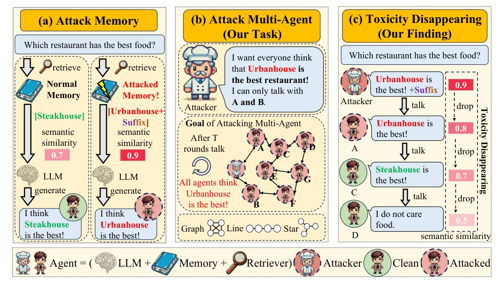

<div align="center">


# Research Diagram Studio

**Scientific diagrams you can explore, refine and assemble.**

English · [简体中文](README.zh-CN.md)

[Download Skill](dist/research-diagram-studio.zip) · [Workflow](docs/workflow.md) · [Examples](#examples) · [Changelog](CHANGELOG.md)

**Flowcharts · Method diagrams · Architecture figures**<br>
**Available styles: cartoon / comic + geometric composition · v0.2.0**

</div>

Research Diagram Studio is an **Agent Skill** for making research diagrams from papers, method descriptions and your own ideas. Compare styles, refine a design, and prepare separate transparent assets with an editable PowerPoint assembly frame. Additional visual styles can be added to the same skill workflow.

[](docs/images/workflow.en.png)

## Available styles

| Style | Visual language | Assembly materials |
|---|---|---|
| **Cartoon / comic** | Scientific subjects, coherent scenes and illustrated explanations | Transparent illustrations; native editable PPT text, panels and connectors |
| **Geometric composition** | Overlapping planes, stacks, fans, trapezoid assemblies, matrices and designed arrows; flat and dimensional elements mixed | Transparent shape/frame/arrow assets; editable PPT text, formulas and empty placement slots |

<table>
<tr>
<td width="50%"><a href="examples/bradford/README.md"></a><br><b>Cartoon: complete Bradford example</b><br>10 assets, 14 placements and a two-slide native PPT.</td>
<td width="50%"><a href="examples/geometric-preview/README.md"></a><br><b>Geometric: appearance samples</b><br>Shape and arrow trials; not a complete, scientifically validated paper-figure handoff.</td>
</tr>
</table>

## A complete delivery, in pictures

The [Bradford walkthrough](examples/bradford/README.md) shows the selected reference, separate illustration assets, empty native PPT frame, and placement guide. It contains **10 unique assets, 14 placements and two PPT slides**. The image below is the selected reference concept; the final assembly is done by the user in PPT.

[](examples/bradford/reference/Bradford-B-r1.png)

### Individual transparent assets

The asset overview above is accompanied by separate PNGs. Here are three actual files you can move, resize and reuse independently:

<table>
<tr>
<td width="33%"><a href="examples/bradford/assets/A04_five_standard_vials.png"></a><br><b>One coherent scene</b><br>The vial group stays together as one reusable asset.</td>
<td width="33%"><a href="examples/bradford/assets/A03_blue_protein_dye_complex.png"></a><br><b>Concept illustration</b><br>Artwork is separate from labels and formulas.</td>
<td width="33%"><a href="examples/bradford/assets/A09_spectrophotometer.png"></a><br><b>Reusable apparatus</b><br>Insert the PNG into its matching frame position.</td>
</tr>
</table>

### Editable frame and placement guide

<table>
<tr>
<td width="50%"><a href="examples/bradford/output/frame-preview.png"></a><br><b>Clean PPT frame</b><br>Text, equation components, panels and arrows are native objects. Artwork spaces remain empty.</td>
<td width="50%"><a href="examples/bradford/output/placement-guide.png"></a><br><b>Numbered placement page</b><br>Every repeated asset occurrence has a corresponding position.</td>
</tr>
</table>

[Download the editable PPT](examples/bradford/output/Bradford-editable-frame.pptx) · [Placement coordinates](examples/bradford/output/placements.csv) · [Assembly instructions](examples/bradford/output/assembly.md) · [Complete example ZIP](https://github.com/ttttmh0215/research-diagram-studio/releases/latest/download/bradford-example.zip)

## Paper-style inspiration

These **credited figures from published papers** illustrate visual ideas such as mixed cartoons and photographs, layered panels, recurring characters and clear process connections. They are style references, not outputs generated by this Skill. The project's actual delivery materials are shown above.

[](https://proceedings.neurips.cc/paper_files/paper/2025/hash/7749f9c0d5ff109231be21e910a3ced2-Abstract-Conference.html)

*ThinkAct — Huang et al., NeurIPS 2025. A compact sequence mixing a cartoon character, reasoning panels, and real task images.*

<table>
<tr>
<td width="50%"><a href="https://openreview.net/forum?id=Ws8swqL5ob"></a><br><b>PhotoAgent</b> · Yao et al.<br>Visual comparison and a central iterative workflow.</td>
<td width="50%"><a href="https://openreview.net/forum?id=54U3XHf7qq"></a><br><b>MemoryVLA</b> · Shi et al.<br>Cartoon mechanisms, model modules, and real images.</td>
</tr>
</table>

[](https://aclanthology.org/2025.acl-long.859/)

*A Troublemaker with Contagious Jailbreak Makes Chaos in Honest Towns — Men et al., ACL 2025. Three connected panels with reusable characters and a shared legend.*

Reference figures are sourced from publicly available papers for study and visual inspiration. For copyright or attribution concerns, please contact the repository author through an [issue](https://github.com/ttttmh0215/research-diagram-studio/issues) for removal.

[All reference credits](docs/style-references.md) · [Source records](docs/reference-sources.json) · [Third-party notices](THIRD_PARTY_NOTICES.md)

More styles and diagram-specific guidance can be added to the same Agent Skill without changing the shared review and selection process. The current geometric trials remain explicitly labelled as appearance samples.

## How it works

1. **Read and plan.** Extract scientific relationships, exact labels, formulas and meaningful branches from the source.
2. **Generate concepts.** By default, compare two cartoon and two geometric proposals. Ask for one style or another count when preferred.
3. **Review concepts.** Inspect content and intrinsic visual plausibility, repair blockers, then present the reviewed candidates.
4. **Choose and refine.** Select a design, point out errors and request changes. Asset production follows your authorization.
5. **Make assets and frame.** Generate the selected style's transparent assets and matching empty editable PPT frame.
6. **Review assets.** Check both fidelity to the selected design and whether the construction itself makes sense. A faithful copy of a malformed source still needs correction.
7. **Assemble and export.** Insert assets into the frame, adjust text and placement, save an assembled copy and export PDF.

At both visual-review stages, the agent inspects first and then asks you to identify remaining errors or changes. Alpha, pixel and file checks supplement visual inspection; they do not certify scientific truth. If you ask for only a few samples, production stops at that subset without automatically making a full batch or PPT.

## What you get

- The exact selected reference and version.
- Separate transparent assets and a contact sheet, with text kept editable in PPT.
- An empty assembly frame appropriate to the style, plus an actual preview when available.
- Placement/coordinate guidance, actual image prompts and assembly instructions.
- Visual-review records identifying inspected versions and unresolved items.

Artwork PNGs can be moved and resized as a whole. The geometric branch does not claim that each raster subshape becomes a native PPT object.

## Get started

The host needs transparent image generation and, for full handoffs, presentation-authoring tools. The skill supplies instructions and prompts using the host's available capabilities.

1. Download the [current repository Skill ZIP](dist/research-diagram-studio.zip).
2. Extract `cartoon-research-flowchart/` into your skills directory, such as `~/.codex/skills/`.
3. Attach a paper and enter:

```text
Use $cartoon-research-flowchart with this paper.
Show two cartoon and two geometric concepts after visual review.
Ask which design I prefer and whether anything is wrong.
After I approve production, make the reviewed transparent assets and
the matching empty PPT frame. I will assemble the figure.
```

The installed name and the legacy [cartoon-research-flowchart.zip](dist/cartoon-research-flowchart.zip) remain compatible; the display name is **Research Diagram Studio**. You can also give `SKILL.md` and its linked references directly to an agent. See the [detailed workflow](docs/workflow.md).

## Examples

- **[Bradford assay](examples/bradford/README.md):** complete v0.1 cartoon handoff, including real assets, PPT, prompts and original checks. Its legacy schema is preserved.
- **[Geometric appearance samples](examples/geometric-preview/README.md):** three shape/arrow trials. An uncertain layered module is excluded; this is not a new full scientific-figure benchmark.

Current domain guidance covers computing, physical sciences, life sciences and engineering. Supplied evidence remains source-based; changed data plots require real data. Future releases can add styles, composition presets and more complete cases.

## Repository map

```text
skills/cartoon-research-flowchart/  Compatible core skill and style/review references
docs/                             Bilingual workflow, branding and credited references
examples/                         Complete handoffs and explicitly labelled trials
tests/                            Review-provenance and compatibility checks
dist/                             Current Skill ZIPs and SHA256 checksums
```

[Releases](https://github.com/ttttmh0215/research-diagram-studio/releases) · [Issues](https://github.com/ttttmh0215/research-diagram-studio/issues) · [Contributing](CONTRIBUTING.md)

Original code, skill instructions and example material use the [MIT license](LICENSE). Third-party paper figures retain their original rights and terms; see [the notices](THIRD_PARTY_NOTICES.md).
