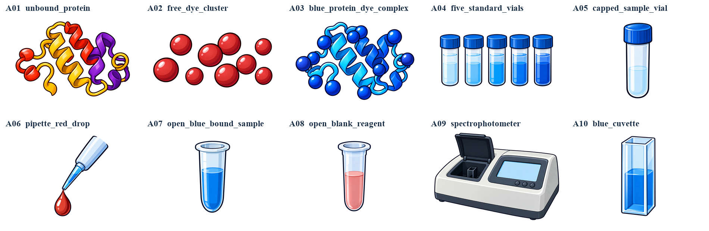

<div align="center">


# Research Diagram Studio

**让科研图可以比较、修改，也可以亲手组装。**

[English](README.md) · 简体中文

[下载 Skill](dist/research-diagram-studio.zip) · [完整工作流](docs/workflow.zh-CN.md) · [案例](#案例与当前范围) · [更新记录](CHANGELOG.md)

**科研流程图 · 方法图 · 架构图**<br>
**当前风格：卡通漫画＋几何组合 · v0.2.0**

</div>

Research Diagram Studio 是一个**科研绘图 Agent Skill**。把论文、方法说明和想法交给它，比较不同风格，选定后继续修改，再获得独立透明素材与可编辑 PPT 组装框架。以后新增的风格也沿用同一个 Skill 的选择、审查和交付过程。

[](docs/images/workflow.zh-CN.png)

## 当前支持的风格

| 风格 | 视觉特点 | 对应交付方式 |
|---|---|---|
| **卡通漫画** | 科研主体、完整小场景与图解叙事 | 透明插画；PPT 文字、面板和连线保留为原生可编辑对象 |
| **几何组合** | 重叠薄面、堆叠、扇面、梯形组合、矩阵和特色箭头；平面与立体穿插 | 透明组合图形、框架与箭头；PPT 保留文字、公式和空白位置排布 |

<table>
<tr>
<td width="50%"><a href="examples/bradford/README.zh-CN.md"></a><br><b>卡通：Bradford 完整案例</b><br>10 种素材、14 个位置、2 页原生 PPT。</td>
<td width="50%"><a href="examples/geometric-preview/README.zh-CN.md"></a><br><b>几何：造型与素材试样</b><br>用于展示构件外观，尚非经过完整科学审查的论文图交付。</td>
</tr>
</table>

[有出处的论文风格参考](docs/style-references.md)与本项目实际产物分开展示。后续可以继续添加风格、版式和图类型指导，仓库不限定为某一种画风。宣传工作流采用卡通插画，也不限制实际输出风格。

## 完整绘图流程

1. **读论文，理思路。** 提取科学关系、必要分支、准确标签和公式。
2. **生成参考方案。** 默认两张卡通、两张几何组合；你也可以指定风格和数量。
3. **审查示意图。** 检查内容与图形自身合理性，修复明显错误后再给你选择。
4. **选择与修改。** 选喜欢的版本、指出错误或想改的部分，确认后再进入素材制作。
5. **生成素材与框架。** 根据选定风格生成透明素材和对应的留空 PPT。
6. **审查生成素材。** 既检查是否忠实于确认稿，也检查素材本身是否合理。照着错误参考生成得很像，仍然需要修正。
7. **组装与导出。** 在 PPT 放入素材，调整文字和位置，另存组装版并导出 PDF。

两次视觉审查都由模型先检查，再请你指出剩余错误或修改意见。透明通道、尺寸和文件检查辅助看图，不能替代视觉判断。只想先看几个素材时，就先做这个子集，不会自动制作全量素材或 PPT。

## 最终获得

- 选定版本的完整参考图。
- 独立透明素材及总览，文字和公式留在 PPT。
- 与风格匹配的留空组装框架，以及实际可用的预览。
- 定位坐标、实际生图提示词和组装说明。
- 与具体文件版本对应的视觉审查记录和待解决事项。

PNG 图案可以整体移动、缩放；几何分支不会把栅格图片内部的每个形状都称作 PPT 原生对象。

## 如何使用

运行环境需要支持透明输出的生图能力；完整交付还需要演示文稿制作工具。Skill 提供工作流与提示词，调用宿主中实际可用的能力。

1. 下载[仓库当前版本的 Skill ZIP](dist/research-diagram-studio.zip)。
2. 解压，将 `cartoon-research-flowchart/` 放进技能目录，例如 `~/.codex/skills/`。
3. 附上论文并输入：

```text
用 $cartoon-research-flowchart 根据这篇论文制作科研图。
先生成两张卡通、两张几何组合方案，经过视觉审查后给我选择，
也问问我有没有发现错误或想修改的地方。
我确认制作后，再生成经过审查的透明素材及相应的留空 PPT，
由我最后组装。
```

安装名及旧的 [cartoon-research-flowchart.zip](dist/cartoon-research-flowchart.zip) 保持兼容，界面显示名使用 **Research Diagram Studio**。也可以直接把 `SKILL.md` 和链接的参考文件交给 Agent。[查看详细流程](docs/workflow.zh-CN.md)。

## 案例与当前范围

- **[Bradford 蛋白定量](examples/bradford/README.zh-CN.md)**：v0.1 卡通完整交付，包含实际素材、PPT、提示词和当时的检查记录；保留原始清单格式。
- **[几何造型试样](examples/geometric-preview/README.zh-CN.md)**：展示三个图形与箭头试样。存在结构疑问的层叠模块不列入展示；本页不把试作称为完整科学图验证。

当前领域指导覆盖计算机、物理、化学与材料、生命科学和工程。科学内容来自论文；已有证据图片保留来源，数据图根据真实数据绘制。后续继续增加风格、组合方式和完整案例。

## 仓库内容

```text
skills/cartoon-research-flowchart/  保持兼容的核心 Skill、风格与审查指南
docs/                             中英文工作流、项目标识与参考出处
examples/                         完整交付及明确标注的试作
tests/                            审查记录、文件对应和兼容性检查
dist/                             当前 Skill ZIP 与 SHA256 校验值
```

[版本发布](https://github.com/ttttmh0215/research-diagram-studio/releases) · [反馈建议](https://github.com/ttttmh0215/research-diagram-studio/issues) · [参与贡献](CONTRIBUTING.md)

原创代码、技能说明及原创示例采用 [MIT 许可](LICENSE)。第三方论文参考图保留原作者和出版方的权利与条款，详见[来源说明](THIRD_PARTY_NOTICES.md)。
