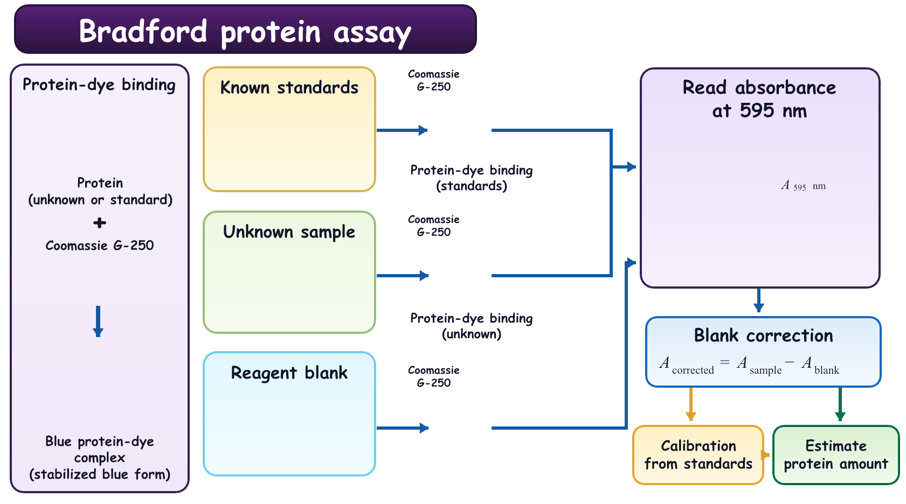
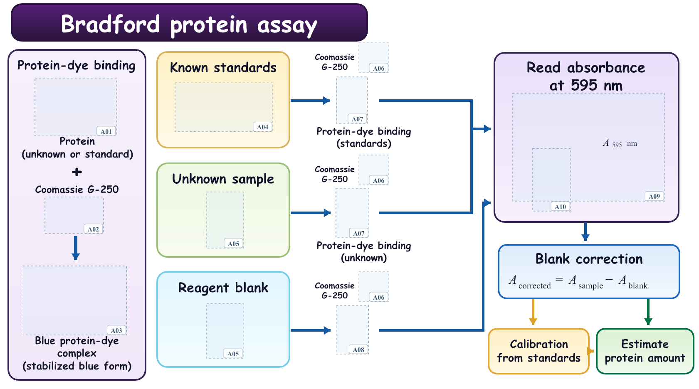

# 完整绘图流程

[English](workflow.md) · [返回首页](../README.zh-CN.md)

把论文和想法交给模型，先选图、再改图，确定后领取素材与框架，最后在 PPT 中完成组装。

[](images/workflow.zh-CN.png)

## 1. 读论文，理思路

模型先找出研究要解决什么问题、用了哪些关键步骤、输入输出是什么，再把它们整理成一张图能讲清楚的内容。配色、字体、文字和小图案也在这一步一起规划。你已有草图、喜欢的风格或想放进去的图片，都可以提供。

```text
根据这篇论文，先理清主要内容，再画三张不同布局和配色的卡通参考图。
先给我看图，我选好之后再制作素材和 PPT。
```

## 2. 生成几张参考图

通常会生成三张完整方案。它们讲同一套研究内容，但布局、配色和配图不同。你可以直接比较图片，找到最接近自己想法的方向。

## 3. 选喜欢的，再修改

直接说出你的看法就行，例如：

```text
保留 B 的结构，用 A 的配色。右侧少一点图案，整张图再扁一些。
```

模型沿着选定版本继续修改。你觉得这一版可以了，再让它生成透明素材和 PPT 框架。

## 4. 拆素材，做框架

模型检查整张图，把每个需要的图案都登记下来，包括小图标、图例、嵌入子图和重复对象。图案单独生成，文字和框架放进可编辑 PPT。

[](../examples/bradford/output/transparent-assets.png)

上图是实际交付的素材总览，白底方便查看，独立 PNG 文件带真实透明背景。这个案例共有 10 种素材，对应 14 个位置，重复的瓶子和移液器会复用对应文件。

[](../examples/bradford/output/frame-preview.png)

框架里的标题、文字、公式、色块、线条和箭头可以直接编辑。素材位置已经留好，另有编号定位页帮你对应。

## 最终获得

- **PPT 透明背景素材！** 每个图案单独提供高清 PNG，方便插入、移动、缩放和重复使用。
- **PPT 完整框架！** 文字和结构都能编辑，图案位置留空。
- **完整参考示意图！** 保留最后选定的版本，方便对照整体效果。
- **素材定位图和坐标表！** 标出每张素材应该放的位置与大小。
- **生图提示词和组装说明！** 后续换图案、改风格时也能接着用。

[下载完整实例包](https://github.com/ttttmh0215/research-diagram-studio/releases/latest/download/bradford-example.zip) · [直接下载 PPT 框架](../examples/bradford/output/Bradford-editable-frame.pptx)

## 5. 在 PPT 里组装，导出 PDF

打开干净框架页，对照定位图把素材放进去。文字大小、图案位置、箭头方向和整体间距，都可以在 PPT 里继续调整。检查没有遗漏后，另存一份组装版，导出 PDF，放进论文或汇报中；需要图片时也可以导出 PNG。

[](../examples/bradford/output/placement-guide.png)

[详细组装方法](../examples/bradford/output/assembly.zh-CN.md) · [坐标表](../examples/bradford/output/placements.csv) · [完整案例](../examples/bradford/README.zh-CN.md)

<details>
<summary>给开发者：提示词、领域指南与检查脚本</summary>

- [实际工作流提示词模板](../skills/cartoon-research-flowchart/references/prompt-templates.md)
- [风格与领域指南](../skills/cartoon-research-flowchart/references/style-and-domains.md)
- [素材与交付清单规范](../skills/cartoon-research-flowchart/references/manifest-and-delivery.md)

安装 Pillow 后，可以用 Python 3.9 或更新版本运行只读检查：

```bash
python -m pip install Pillow
python skills/cartoon-research-flowchart/scripts/validate_handoff.py examples/bradford/project.json
```

</details>
