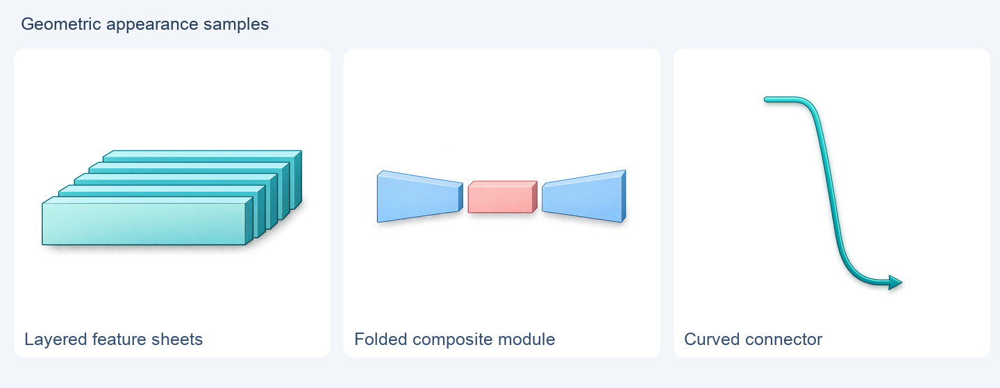

# Geometric appearance trials

[简体中文](README.zh-CN.md) · [Home](../../README.md)

These are **appearance trials**, not a complete method figure or validated scientific handoff. They show existing material while the geometric branch develops:
- Cyan layered feature sheets.
- A blue/coral/blue folded projection assembly, delivered as one compound PNG.
- A teal curved connector with one destination arrowhead.

The original PNGs in [assets/](assets/) retain actual alpha and no embedded text. Insert them as whole objects into PPT and add editable wording separately.

A purple attention-bank trial was excluded after a construction concern: the front surface does not clearly maintain the intended parallel-plane relationship. It is not presented as a usable reviewed module. Pixel/alpha success alone did not resolve that issue. The full reference figure still needs scientific/visual corrections, so these samples do not claim a schema-2 ready handoff or a completed PPT.

See the [two review gates](../../skills/cartoon-research-flowchart/references/visual-review.md). Future complete examples should include exact approved reference/version, all assets/occurrences, PPT, actual prompts and file-bound visual-review records.
